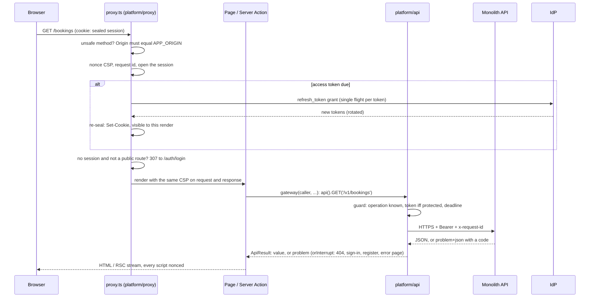

# Architecture overview

global-architecture-web is one Next.js 16 App Router app in front of
global-architecture-monolith's HTTPS API. It renders every page on the server, holds the
OIDC tokens there, and calls the API on behalf of the signed-in person.

## The request lifecycle

## Slices

| Slice              | Role                                                                                   | Rule                                                                               |
| ------------------ | -------------------------------------------------------------------------------------- | ---------------------------------------------------------------------------------- |
| `src/kernel`       | problem codes, form state, money, dates                                                | imports nothing outside itself                                                     |
| `src/platform`     | config, outbound fetch, session, OIDC, proxy, API client, actions, errors, logging     | entered only through `@/platform/<entry>` roots, each by the files it serves       |
| `src/ui`           | shadcn primitives on Base UI, composites                                               | React and UI packages only                                                         |
| `src/features/<f>` | one domain area: `model`, `data`, `views`, `ui`, `actions.ts`, `index.ts`, `server.ts` | its own API paths only; other features through their public entries, when declared |
| `src/app`          | routes: the composition root                                                           | thin pages                                                                         |

`tools/check-boundaries.ts` enforces the slices and layers (R1-R12), `tools/check-access.ts`
the security shape (S1-S10). Both test themselves on `tests/probes` every run.

## Sign-in

1. `GET /auth/login?returnTo=` seals `{state, nonce, PKCE verifier, returnTo}` into a
   10-minute `__Host-Http-gaw-txn` cookie and redirects to the provider (code + PKCE S256).
2. `GET /auth/callback` checks state, nonce, PKCE and the `iss` parameter, exchanges the
   code (`client_secret_basic`), creates a fresh session and asks the API who this is:
   a user goes back to `returnTo`, a new login to `/register`.
3. `/register` posts `POST /v1/users` through a Server Action.
4. `POST /auth/logout` (Origin-checked) clears the cookie and leaves through the
   provider's end-session endpoint with `id_token_hint`.

Locally the provider is the monolith's dev IdP: a form that signs in any subject, with an
access-token lifetime knob for testing refresh.

## Data and mutations

- Reads: async Server Components in a feature's `views/` call its `data/` gateways, which
  return `ApiResult<T>`; `orInterrupt` turns problems into a 404, sign-in, registration or
  the error page. Nothing is cached across requests.
- Mutations: `defineAction` in a feature's `actions.ts` checks the session, parses the
  form with Zod, calls a gateway, maps problems to fields and messages, then redirects or
  refreshes. Forms are plain `<form action>` with `useActionState`, so they work before
  hydration.
- The contract: `contracts/monolith/openapi.json` (committed, pinned to a monolith commit)
  generates the types and an operations table; `pnpm api:check` keeps them in step.

## Adding a feature

In the monolith: `pnpm new:module review`, shape it, `pnpm stack:up`. Here:
`pnpm api:sync --allow-dirty`, `pnpm new:feature review`, reshape `model/`, `data/`,
`ui/` and `views/`, keep the five problem tests and the five access tests, `pnpm check`.
The `gaw-new-feature` skill has the details.

## Decisions

`docs/architecture/adr/`: 0001 platform stack, 0002 feature slices and boundaries, 0003
BFF authentication and session, 0004 data access, mutations and the API contract, 0005 UI
system, 0006 rendering, caching and browser security, 0007 testing, local stack and CI.
`threat-model.md` maps each security guarantee to what enforces it and what proves it.
